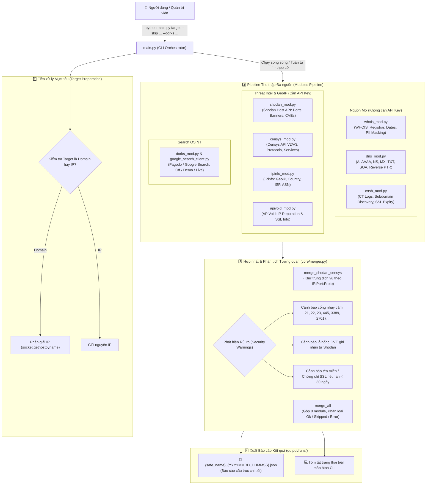

# Application of Python in Passive Reconnaissance in the Field of Information Security
### 🔍 Passive Recon Toolkit (Nhóm 1 - G1)

> **Môn học:** Python cho An toàn thông tin (**SEC1302 - Python for Information Security**)  
> **Học kỳ:** Học kỳ 1, Năm học 2026–2027  
> **Đơn vị:** Học viện Công nghệ Bưu chính Viễn thông (**PTIT - Posts and Telecommunications Institute of Technology**)  
> **Giáo trình tham khảo nền tảng:** Nishant Krishna, *Python for Cybersecurity Cookbook*, Packt Publishing.

[](https://www.python.org/)
[](#thông-tin-đề-tài--nhân-sự-project-identity)
[](#nguyên-tắc-an-toàn--pháp-lý-ethics--legal-disclaimer)
[](#triết-lý-trinh-sát-bị-động-100-passive)
[](#kiểm-thử-hệ-thống-test-suite)

---

## 📋 Mục lục

- [Thông tin đề tài & Nhân sự (Project Identity)](#-thông-tin-đề-tài--nhân-sự-project-identity)
- [Tổng quan & Triết lý Trinh sát Bị động](#-tổng-quan--triết-lý-trinh-sát-bị-động)
- [Kiến trúc hệ thống & Luồng hoạt động](#-kiến-trúc-hệ-thống--luồng-hoạt-động)
- [Cấu trúc mã nguồn Repository](#-cấu-trúc-mã-nguồn-repository)
- [Yêu cầu hệ thống & Cài đặt](#-yêu-cầu-hệ-thống--cài-đặt)
- [Cấu hình biến môi trường (.env)](#-cấu-hình-biến-môi-trường-env)
- [Hướng dẫn sử dụng CLI](#-hướng-dẫn-sử-dụng-cli)
- [Chi tiết 8 Module OSINT & Core Merger](#-chi-tiết-8-module-osint--core-merger)
- [Hệ thống Cảnh báo Rủi ro Tự động (Risky Ports & Warnings)](#-hệ-thống-cảnh-báo-rủi-ro-tự-động-risky-ports--warnings)
- [Kiểm thử hệ thống (Test Suite)](#-kiểm-thử-hệ-thống-test-suite)
- [Định dạng kết quả đầu ra (Output Format)](#-định-dạng-kết-quả-đầu-ra-output-format)
- [Nguyên tắc an toàn & Pháp lý (Ethics & Legal Disclaimer)](#-nguyên-tắc-an-toàn--pháp-lý-ethics--legal-disclaimer)
- [Tài liệu tham khảo (References)](#-tài-liệu-tham-khảo-references)

---

## 👥 Thông tin đề tài & Nhân sự (Project Identity)

* **Tên đề tài (#01):** *Application of Python in Passive Reconnaissance in the Field of Information Security* (Ứng dụng Python trong trinh sát bị động trong lĩnh vực An toàn thông tin).
* **Nhóm thực hiện:** Nhóm 1 (**Team G1**).
* **Giảng viên hướng dẫn:** ThS. Phan Nghĩa Hiệp (`hieppn@ptithcm.edu.vn`).

### Bảng phân công nhân sự & Vai trò chuyên môn

| Vai trò / MSSV | Họ và tên | GitHub / Liên hệ | Email sinh viên | Phân công chuyên môn chính trong dự án |
|:---:|---|:---:|---|---|
| **Giảng viên** | **ThS. Phan Nghĩa Hiệp** | GVHD | `hieppn@ptithcm.edu.vn` | Định hướng đề tài, phản biện & đánh giá chuyên môn |
| **N25DCAT086** | **Hồ Thị Trúc Linh**<br>*(Trưởng nhóm)* | [@linh-h-annanie](https://github.com/linh-h-annanie) | `n25dcat086@student.ptithcm.edu.vn` | • Thiết kế kiến trúc tổng thể module OSINT nền tảng.<br>• Xây dựng module `whois_mod.py` (WHOIS, EPP, PII masking).<br>• Xây dựng module `dns_mod.py` (DNS 7 records, multi-threaded PTR reverse, chống private IP).<br>• Xây dựng module `crtsh_mod.py` (CT Logs, subdomain deduplication, cảnh báo hết hạn cert).<br>• Xây dựng 21 bài kiểm thử tự động `tests/test_whois_dns_crtsh.py`. |
| **N25DCAT099** | **Thân Lê Nhật Quang** | [@lailawan](https://github.com/lailawan) | `n25dcat099@student.ptithcm.edu.vn` | • Nghiên cứu & tích hợp Shodan Host API (`modules/shodan_mod.py`).<br>• Tích hợp Censys Search API V2/V3 (`modules/censys_mod.py`).<br>• Xây dựng thuật toán hợp nhất mạng `merge_shodan_censys` trong `core/merger.py`.<br>• Phát triển bộ kiểm thử `tests/test_shodan_censys.py`. |
| **N25DCAT097** | **Trần Thiên Hoàng Quân** | Thành viên | `n25dcat097@student.ptithcm.edu.vn` | • Nghiên cứu & phát triển module IPinfo (`modules/ipinfo_mod.py` - GeoIP & ASN).<br>• Phát triển module APIVoid (`modules/apivoid_mod.py` - IP Reputation & SSL).<br>• Xây dựng file cấu hình mẫu `.env.example` và bộ dữ liệu mẫu JSON.<br>• Phát triển bộ kiểm thử `tests/test_ipinfo_goc.py`, `tests/test_apivoid_*.py`. |
| **N25DCAT079** | **Đặng Quang Huy** | [@Kurookani](https://github.com/Kurookani) | `n25dcat079@student.ptithcm.edu.vn` | • Nghiên cứu kỹ thuật Google Dorking & Search OSINT.<br>• Tích hợp và đóng gói engine Pagodo (`vendor/pagodo/`).<br>• Phát triển module `dorks_mod.py` và client `google_search_client.py`.<br>• Thiết lập cơ chế an toàn Dry-run / Demo, kiểm soát tốc độ (delay 10–15s) tránh block/CAPTCHA.<br>• Phát triển bộ kiểm thử `tests/test_dorks_mod.py`. |
| **N25DCAT100** | **Thái Mỹ Quyên** | Thành viên | `n25dcat100@student.ptithcm.edu.vn` | • Xây dựng bộ điều phối tập trung `main.py` (CLI Orchestrator, cơ chế skip/dorks).<br>• Xây dựng hàm hợp nhất toàn bộ kết quả `merge_all` trong `core/merger.py`.<br>• Thiết lập hệ thống kiểm thử tích hợp `tests/test_merge_all.py` và báo cáo tổng kết. |

---

## 🎯 Tổng quan & Triết lý Trinh sát Bị động

**Passive Recon Toolkit** là giải pháp phần mềm toàn diện nhằm tự động hóa quy trình thu thập thông tin tình báo an ninh mạng nguồn mở (**OSINT**) trên phạm vi tên miền và địa chỉ IP công khai.

### Triết lý Trinh sát Bị động (100% Passive)
Công cụ tuân thủ nghiêm ngặt nguyên lý **không tác động trực tiếp** tới hạ tầng của mục tiêu:
1. **Không quét cổng (Zero Port Scanning):** Không gửi gói tin TCP SYN/Connect tới máy chủ mục tiêu.
2. **Không thăm dò dịch vụ (Zero Active Probing):** Không gửi HTTP request hay payload khai thác vào ứng dụng của mục tiêu.
3. **Khai thác qua trung gian độc lập:**
   - Dữ liệu đăng ký tên miền công cộng từ các tổ chức quản lý (WHOIS Protocol TCP/43).
   - Hệ thống máy chủ tên miền đệ quy (Recursive DNS Caches).
   - Nhật ký minh bạch chứng chỉ SSL/TLS công khai (Certificate Transparency Logs - RFC 6962).
   - Các công cụ tìm kiếm thiết bị mạng toàn cầu (Shodan, Censys).
   - Cơ sở dữ liệu định vị địa lý và số hiệu mạng (IPinfo GeoIP & ASN).
   - Nền tảng đánh giá danh tiếng địa chỉ IP (APIVoid Threat Intelligence).
   - Chỉ mục tìm kiếm công cộng (Google Dorking & Pagodo).

---

## 🏗️ Kiến trúc hệ thống & Luồng hoạt động



---

## 📂 Cấu trúc mã nguồn Repository

Cấu trúc đồng bộ chính xác theo kho mã nguồn GitHub [linh-h-annanie/passive-recon-toolkit](https://github.com/linh-h-annanie/passive-recon-toolkit):

```text
passive-recon-toolkit/
├── main.py                     # Điểm khởi chạy chính: gọi các module, gộp kết quả, lưu JSON
├── requirements.txt            # Danh mục thư viện phụ thuộc của dự án
├── .env.example                # File mẫu cấu hình biến môi trường và API key
├── .gitignore                  # Cấu hình bỏ qua môi trường ảo, cache, file nhạy cảm
├── README.md                   # Tài liệu hướng dẫn sử dụng và báo cáo đồ án
│
├── core/
│   └── merger.py               # Logic hợp nhất: merge_shodan_censys, merge_all, RISKY_PORTS
│
├── modules/                    # 8 module thu thập dữ liệu chuyên biệt
│   ├── whois_mod.py            # Thu thập WHOIS, chuẩn hóa ngày tháng, che thông tin PII
│   ├── dns_mod.py              # Truy vấn 7 bản ghi DNS và reverse PTR đa luồng
│   ├── crtsh_mod.py            # Khai thác Certificate Transparency logs từ crt.sh
│   ├── shodan_mod.py           # Truy vấn Shodan Host API (ports, services, CVEs)
│   ├── censys_mod.py           # Truy vấn Censys Search API (hỗ trợ cả V2 và V3)
│   ├── ipinfo_mod.py           # Thu thập thông tin vị trí địa lý (GeoIP) và số hiệu ASN
│   ├── apivoid_mod.py          # Kiểm tra độ tin cậy IP (Reputation) và cấu hình SSL
│   ├── dorks_mod.py            # Tự động hóa tìm kiếm tài liệu lộ lọt qua Google Dorks
│   └── google_search_client.py # Client kết nối tìm kiếm Google Search cho module dorks
│
├── vendor/
│   └── pagodo/                 # Engine Pagodo mã nguồn mở đóng gói nội bộ
│       ├── pagodo.py           # Bộ thu thập dorks tự động hóa
│       ├── UPSTREAM.json       # Định danh phiên bản upstream Pagodo
│       └── LICENSE             # Giấy phép bản quyền Pagodo (GPL-3.0)
│
├── tests/                      # Bộ kiểm thử tự động toàn diện
│   ├── test_whois_dns_crtsh.py # 21 unit tests deterministic cho whois, dns, crt.sh
│   ├── test_shodan_censys.py   # Unit tests cho Shodan & Censys & merge_shodan_censys
│   ├── test_ipinfo_goc.py      # Unit tests cho IPinfo module
│   ├── test_apivoid_goc.py     # Unit tests cho APIVoid IP reputation
│   ├── test_apivoid_ssl.py     # Unit tests cho APIVoid SSL information
│   ├── test_dorks_mod.py       # Unit tests cho Google Dorks (parser, retry, limit)
│   ├── test_merge_all.py       # Unit tests cho merge_all và hệ thống cảnh báo cảnh báo
│   └── bangiaominhchunggsgd/   # Dữ liệu minh chứng bàn giao JSON kiểm thử
│
└── output/                     # Thư mục lưu dữ liệu mẫu và kết quả thực thi
    ├── apivoid_sample_8.8.8.8.json
    ├── apivoid_ssl_sample_google.com.json
    ├── example.com_shodan_censys.json
    ├── example.net_shodan_censys.json
    └── runs/                   # Thư mục chứa kết quả các lần chạy main.py
```

---

## 💻 Yêu cầu hệ thống & Cài đặt

### 1. Yêu cầu môi trường
- **Hệ điều hành:** Linux, macOS hoặc Windows 10/11.
- **Python:** Phiên bản `Python 3.10` trở lên (đã kiểm thử ổn định trên Python 3.12 và 3.13).

### 2. Các bước cài đặt

**Bước 1:** Clone mã nguồn từ GitHub:
```bash
git clone https://github.com/linh-h-annanie/passive-recon-toolkit.git
cd passive-recon-toolkit
```

**Bước 2:** Khởi tạo môi trường ảo (`venv`):
- Trên **Linux / macOS**:
  ```bash
  python3 -m venv .venv
  source .venv/bin/activate
  ```
- Trên **Windows (PowerShell)**:
  ```powershell
  python -m venv .venv
  .venv\Scripts\Activate.ps1
  ```

**Bước 3:** Cài đặt các gói phụ thuộc qua `requirements.txt`:
```bash
pip install --upgrade pip
pip install -r requirements.txt
```

---

## ⚙️ Cấu hình biến môi trường (.env)

Hệ thống được thiết kế theo cơ chế **Graceful Degradation**: Nếu không có API Key, các module yêu cầu tài khoản sẽ tự động chuyển trạng thái `skipped` mà **không làm crash hệ thống**. Các module nguồn mở (`whois`, `dns`, `crtsh`) vẫn chạy bình thường.

Để kích hoạt đầy đủ 8 module, tạo file `.env` từ file mẫu `.env.example`:
```bash
cp .env.example .env
```

Điền các khóa API mà nhóm hoặc cá nhân sở hữu:
```ini
# Khóa API tra cứu vị trí địa lý & ASN
IPINFO_TOKEN=your_ipinfo_token_here

# Khóa API kiểm tra danh tiếng địa chỉ IP
APIVOID_API_KEY=your_apivoid_api_key_here

# Khóa API Shodan Host Search
SHODAN_API_KEY=your_shodan_api_key_here

# Cấu hình Censys API (Hỗ trợ định dạng V3 hoặc V2)
CENSYS_API_TOKEN=your_censys_token_here
CENSYS_ORG_ID=your_censys_org_id_optional

# Hoặc Censys API V2 thông thường:
# CENSYS_API_ID=your_censys_api_id_here
# CENSYS_API_SECRET=your_censys_api_secret_here
```

---

## 🚀 Hướng dẫn sử dụng CLI

Cú pháp lệnh chính xác từ `main.py`:
```text
python main.py <target> [--skip MODULE ...] [--dorks {off,demo,live}]
```

### 1. Quét mục tiêu thông thường (Khuyến nghị)
Mặc định chạy tất cả các module chính, tắt dorks để đảm bảo tốc độ và tránh bị Google chặn:
```bash
python main.py example.org
```

### 2. Quét một địa chỉ IP
Hệ thống tự động nhận diện IP, chuyển trực tiếp cho các module hỗ trợ IP (`dns`, `shodan`, `censys`, `ipinfo`, `apivoid`):
```bash
python main.py 8.8.8.8
```

### 3. Bỏ qua các module chỉ định (Cờ `--skip`)
Nếu muốn bỏ qua các module tốn thời gian hoặc chưa có API key:
```bash
python main.py example.com --skip shodan censys apivoid dorks
```

### 4. Kích hoạt tính năng Google Dorking (Cờ `--dorks`)
- **Chế độ Demo (`--dorks demo`):** Sử dụng dữ liệu giả định chuẩn hóa phục vụ kiểm thử offline, kiểm tra luồng tích hợp an toàn:
  ```bash
  python main.py example.com --dorks demo
  ```
- **Chế độ Live (`--dorks live`):** Gửi truy vấn dorking thật qua Google Search / Pagodo (hệ thống tự động áp dụng jitter delay 10–15s giữa các dork để bảo vệ IP):
  ```bash
  python main.py example.com --dorks live
  ```

---

## 🧩 Chi tiết 8 Module OSINT & Core Merger

| Module | Tệp tin mã nguồn | Công nghệ / Nguồn | Đầu vào | Chức năng & Dữ liệu trích xuất chính |
|---|---|---|:---:|---|
| **WHOIS** | `modules/whois_mod.py` | `python-whois` (TCP/43) | Domain | Tra cứu registrar, ngày tạo, ngày hết hạn, `days_to_expiry`, name servers, trạng thái EPP, DNSSEC, **tự động che mờ email (PII Masking)**, timeout an toàn chống treo tiến trình. |
| **DNS** | `modules/dns_mod.py` | `dnspython`, `socket` (UDP/53) | Domain / IP | Phân giải đồng thời 7 bản ghi (`A`, `AAAA`, `NS`, `MX`, `TXT`, `CNAME`, `SOA`); phân tích SPF/DMARC; tra cứu ngược **Reverse DNS PTR** đa luồng; **chặn tuyệt đối IP private/loopback** (RFC 1918). |
| **crt.sh** | `modules/crtsh_mod.py` | `requests` (crt.sh JSON API) | Domain | Thu thập Subdomains từ Certificate Transparency Logs; **khử trùng lặp thông minh giữa pre-cert và final-cert**; phát hiện chứng chỉ SSL/TLS hết hạn hoặc sắp hết hạn trong 30 ngày; cơ chế retry với exponential backoff. |
| **Shodan** | `modules/shodan_mod.py` | `shodan` / REST API | Domain / IP | Tra cứu lịch sử quét thụ động của Shodan: phát hiện cổng mở, banners, dịch vụ, hệ điều hành và danh sách **lỗ hổng CVE đã biết**. |
| **Censys** | `modules/censys_mod.py` | `requests` (Censys V2/V3) | Domain / IP | Truy vấn dữ liệu tài sản mạng toàn cầu từ Censys Search API; bổ sung dịch vụ mạng, giao thức và dấu vết phần mềm. |
| **IPinfo** | `modules/ipinfo_mod.py` | `ipinfo` SDK | IP | Định vị địa lý GeoIP (quốc gia, thành phố, tọa độ `loc`), thông tin nhà mạng (ISP/Org), mã Autonomous System Number (**ASN**). |
| **APIVoid** | `modules/apivoid_mod.py` | `requests` (APIVoid v2) | IP / Domain | Đánh giá điểm tín nhiệm rủi ro (**IP Reputation score**), phát hiện IP proxy/VPN/Tor/Spam, phân tích thông số kỹ thuật chứng chỉ SSL/TLS mở rộng. |
| **Google Dorks** | `modules/dorks_mod.py` | `vendor/pagodo`, Google Client | Domain | Tự động hóa tìm kiếm tài liệu nhạy cảm (`filetype:pdf`, `intitle:"documentation"`), trang quản trị; hỗ trợ chế độ `off`, `demo`, `live` với khoảng nghỉ ngẫu nhiên 10–15s. |

### Module Hợp nhất Trung tâm (`core/merger.py`)
1. **`merge_shodan_censys(shodan_result, censys_result)`:**
   - Gom cụm thông tin máy chủ (`hosts`), tổng hợp danh sách cổng và lỗ hổng CVE từ cả Shodan và Censys.
   - Hợp nhất dịch vụ (`services`) và khử trùng lặp theo bộ ba khóa duy nhất `(ip, port, transport)`.
   - Kết hợp nhãn dịch vụ, sản phẩm (`product`), phiên bản (`version`) và banner từ nguồn tương ứng.
2. **`merge_all(target, results)`:**
   - Tập hợp kết quả từ toàn bộ 8 module thành cấu trúc từ điển thống nhất.
   - Thống kê tóm tắt theo trạng thái: `summary.ok`, `summary.skipped` (kèm nguyên nhân), `summary.error`.
   - Giữ lại dữ liệu một phần (`partial_data`) nếu module gặp sự cố ngắt quãng (ví dụ: Google chặn giữa chừng).

---

## 🚨 Hệ thống Cảnh báo Rủi ro Tự động (Risky Ports & Warnings)

`core/merger.py` tích hợp sẵn bộ luật phân tích rủi ro an ninh mạng tự động:

### 1. Cảnh báo Cổng dịch vụ nhạy cảm (`RISKY_PORTS`)
Hệ thống sẽ gắn cờ cảnh báo rủi ro cao nếu phát hiện các cổng mở nhạy cảm, dễ bị khai thác tấn công brute-force hoặc lộ dữ liệu:
* **Quản trị từ xa:** `22` (SSH), `23` (Telnet), `3389` (RDP).
* **Chia sẻ tập tin & mạng nội bộ:** `21` (FTP), `445` (SMB).
* **Hệ quản trị cơ sở dữ liệu:** `1433` (MSSQL), `3306` (MySQL), `5432` (PostgreSQL), `6379` (Redis), `27017` (MongoDB).

```text
Exposed sensitive service on 1.2.3.4:22/tcp (SSH) via Shodan, Censys
Exposed sensitive service on 1.2.3.4:3389/tcp (RDP) via Shodan
```

### 2. Cảnh báo Lỗ hổng CVE
Nếu Shodan ghi nhận IP mục tiêu tồn tại các mã lỗ hổng CVE công khai:
```text
1.2.3.4 has 3 known CVE(s) in Shodan: CVE-2021-41773, CVE-2021-42013, CVE-2022-22965
```

### 3. Cảnh báo Hạn sử dụng Tên miền & Chứng chỉ SSL
* **Tên miền:** Cảnh báo nếu tên miền còn dưới 30 ngày là hết hạn (`Domain expires in X day(s)`) — nguy cơ bị cướp tên miền (Domain Hijacking).
* **Chứng chỉ SSL:** Cảnh báo nếu có chứng chỉ SSL/TLS hết hạn trong vòng 30 ngày (`X certificate(s) expire within 30 days`).

---

## 🧪 Kiểm thử hệ thống (Test Suite)

Dự án chú trọng chất lượng mã nguồn và độ tin cậy bằng hệ thống kiểm thử tự động, áp dụng phương pháp **Deterministic Testing / Mocking** (không gửi request ra ngoài Internet khi chạy test).

### Chạy toàn bộ Test Suite:
```bash
python -m unittest discover -s tests -v
```

### Các nhóm kiểm thử độc lập:
1. **`tests/test_whois_dns_crtsh.py` (21 tests của Linh):**
   - Kiểm tra `whois_mod`: Xử lý phản hồi dict subclass, khử trùng, che email PII, cơ chế ThreadPool timeout không treo tiến trình.
   - Kiểm tra `dns_mod`: Chặn phân giải IP private (RFC 1918), timeout reverse PTR, ghép chuỗi TXT/SPF nhiều dòng, phân biệt không có bản ghi với NXDOMAIN.
   - Kiểm tra `crtsh_mod`: Khử trùng pre-cert & final-cert, lọc wildcard, cơ chế tự động retry khi gặp HTTP 404/429/5xx hoặc trang HTML, từ chối phản hồi quá lớn (>30MB).
   - Kiểm tra tính tương thích: Khớp chữ ký `run(target, config)`, xác thực domain hợp lệ, hợp đồng dữ liệu chuẩn.
2. **`tests/test_shodan_censys.py` (của Quang):**
   - Kiểm tra chuẩn hóa và khử trùng dịch vụ giữa Shodan và Censys theo `(ip, port, transport)`.
   - Kiểm tra trích xuất danh sách CVE từ Shodan.
3. **`tests/test_merge_all.py` (của Quyên / Quang):**
   - Kiểm tra logic nhóm trạng thái `ok`, `skipped`, `error`.
   - Kiểm tra cơ chế sinh cảnh báo khi domain hết hạn < 30 ngày và phát hiện `RISKY_PORTS`.
4. **`tests/test_ipinfo_goc.py` & `test_apivoid_*.py` (của Quân):**
   - Kiểm tra cấu trúc dữ liệu GeoIP, ASN và phân tích danh tiếng IP.
5. **`tests/test_dorks_mod.py` (của Huy):**
   - Kiểm tra parser dorking, chế độ demo offline, xử lý ngoại lệ khi bị Google chặn.

---

## 📊 Định dạng kết quả đầu ra (Output Format)

Khi chạy `main.py`, kết quả được lưu tại `output/runs/<safe_name>_<YYYYMMDD_HHMMSS>.json`:

```json
{
  "target": "example.org",
  "generated_at": "2026-11-28T04:15:00.123456+00:00",
  "summary": {
    "ok": ["whois", "dns", "crtsh", "shodan", "censys", "ipinfo", "apivoid"],
    "skipped": [
      {
        "module": "dorks",
        "reason": "Dorks mode is off"
      }
    ],
    "error": []
  },
  "modules": {
    "whois": {
      "registrar": "Public Interest Registry",
      "creation_date": "1995-01-01T05:00:00+00:00",
      "expiration_date": "2030-01-01T05:00:00+00:00",
      "days_to_expiry": 1130,
      "name_servers": ["a.iana-servers.net", "b.iana-servers.net"],
      "emails_masked": ["c***@iana.org"]
    },
    "dns": {
      "records": {
        "A": ["93.184.215.14"],
        "AAAA": ["2606:2800:21f:cb07:6820:80da:af6b:8b2c"],
        "TXT": ["v=spf1 -all"]
      },
      "ips": ["93.184.215.14"]
    },
    "crtsh": {
      "subdomains": ["www.example.org"],
      "total_certificates": 15,
      "expiring_within_30_days": []
    }
  },
  "network": {
    "services": [
      {
        "ip": "93.184.215.14",
        "port": 80,
        "transport": "tcp",
        "service": "http (Apache)",
        "source": "Shodan, Censys"
      },
      {
        "ip": "93.184.215.14",
        "port": 443,
        "transport": "tcp",
        "service": "https",
        "source": "Shodan, Censys"
      }
    ],
    "hosts": [
      {
        "ip": "93.184.215.14",
        "org": "EDGECAST",
        "asn": "AS15133",
        "country": "United States",
        "ports": [80, 443],
        "vulns": []
      }
    ]
  },
  "warnings": []
}
```

---

## 🔒 Nguyên tắc an toàn & Pháp lý (Ethics & Legal Disclaimer)

> ⚠️ **Tuyên bố miễn trừ trách nhiệm pháp lý:**  
> Công cụ này được thiết kế, phát triển và thử nghiệm hoàn toàn nhằm mục đích **học tập, nghiên cứu học thuật và đánh giá an toàn thông tin được ủy quyền hợp pháp**. Nhóm tác giả và Học viện Công nghệ Bưu chính Viễn thông không chịu trách nhiệm đối với bất kỳ hành vi lạm dụng nào nhằm mục đích xâm nhập trái phép, quấy rối hoặc vi phạm luật pháp hiện hành.

1. **Tuân thủ đạo đức an toàn thông tin:**
   - Chỉ thực hiện trinh sát trên các mục tiêu công khai hoặc mục tiêu đã có văn bản thỏa thuận cho phép đánh giá.
   - Tôn trọng giới hạn của trinh sát bị động: tuyệt đối không phát tán payload hay can thiệp vào tính sẵn sàng của hệ thống.
2. **Bảo vệ quyền riêng tư (Privacy & PII Protection):**
   - Áp dụng kỹ thuật che giấu dữ liệu (Masking) đối với thông tin cá nhân (email liên hệ) trích xuất từ cơ sở dữ liệu WHOIS, tuân thủ tiêu chuẩn GDPR.
3. **Phòng tránh tấn công từ chối dịch vụ (Anti-DoS / Rate Limiting):**
   - Thiết lập giới hạn thời gian kết nối (`timeout`) chặt chẽ cho toàn bộ các hàm gọi mạng.
   - Cơ chế giãn cách truy vấn (Jitter delay 10–15 giây) nhằm tránh gây quá tải lên các dịch vụ tìm kiếm công cộng như crt.sh hay Google.
4. **Bảo mật bí mật thông tin (Secret Management):**
   - File cấu hình chứa API key (`.env`) tuyệt đối không được đưa lên các kho lưu trữ Git công cộng.

---

## 📚 Tài liệu tham khảo (References)

1. **Nishant Krishna**, *Python for Cybersecurity Cookbook*, Packt Publishing, 2020.
2. **RFC 3912:** *WHOIS Protocol Specification*, IETF.
3. **RFC 1034 & RFC 1035:** *Domain Names - Concepts and Facilities / Implementation and Specification*, IETF.
4. **RFC 6962:** *Certificate Transparency*, IETF.
5. **RFC 1918 & RFC 4193:** *Address Allocation for Private Internets / Unique Local IPv6 Unicast Addresses*.
6. **Shodan Developer Documentation:** [https://developer.shodan.io/api](https://developer.shodan.io/api)
7. **Censys Search API Documentation:** [https://search.censys.io/api](https://search.censys.io/api)
8. **IPinfo API Documentation:** [https://ipinfo.io/developers](https://ipinfo.io/developers)
9. **APIVoid API Reference:** [https://www.apivoid.com/api/](https://www.apivoid.com/api/)
10. **Pagodo (Passive Google Dork):** [https://github.com/opsdisk/pagodo](https://github.com/opsdisk/pagodo)

---

*© 2026 Nhóm 1 (Team G1) — SEC1302: Python cho An toàn thông tin — Học viện Công nghệ Bưu chính Viễn thông (PTIT).*
